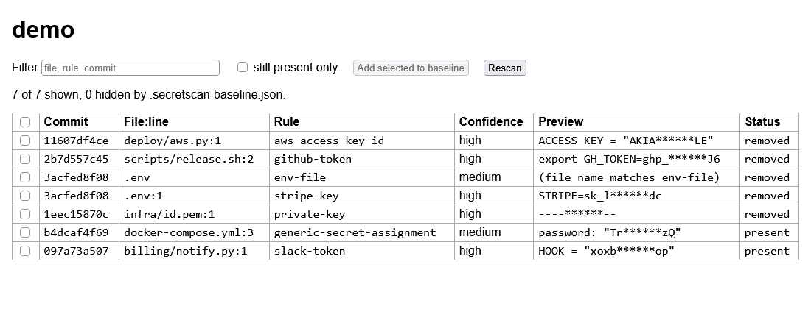

# secretscan

Looks for leaked secrets in a git repo before you push it: API keys, tokens, private keys, passwords in config, committed .env files and high-entropy strings. It scans the working tree and every added line in git history, so a key that was committed and then deleted still gets found. It only reads the repo (through `git ls-files` and `git log -p`) and has no dependencies beyond Node 22+ and git.

## Use

    node bin/secretscan.js                 # scan the repo in the current directory
    node bin/secretscan.js ../other-repo --format json
    node bin/secretscan.js --no-history --min-confidence medium
    node bin/secretscan.js --format sarif > results.sarif

Each finding has the file, commit (or `worktree`), line, rule, confidence, a masked preview and an id. The full secret is never printed or stored. Exit code is 1 when anything is found, 0 when clean, 2 on a usage error, so it works as a CI step.

Known findings can be accepted with a baseline of ids:

    node bin/secretscan.js --write-baseline .secretscan-baseline.json
    node bin/secretscan.js --baseline .secretscan-baseline.json

The id hashes rule, file and secret, so it survives line moves but not a rename. The baseline file holds only hashes. Paths can also be excluded in `.secretscanignore` (gitignore-style: `*`, `**`, `?`, `dir/`, leading `/`; no `!` negation), and a single line can carry `secretscan:ignore`. Lock files, `*.min.js` and similar are skipped by default.

## Browser view

    node bin/secretscan.js ui [path]
    node bin/secretscan.js ui . --no-open --port 8731
    node bin/secretscan.js ui . --browser "C:\Program Files\LibreWolf\librewolf.exe"

Starts a server on 127.0.0.1 (random free port unless `--port`), prints the url and opens it with the OS default handler. `--no-open` skips that, and `--browser <exe>` (or the `BROWSER` environment variable) starts that program with the url instead, which helps when the system default is not the browser you use. Requests with a foreign Host or Origin are refused, the page loads nothing from outside, and nothing is written except what you ask for below.

The page is one table: commit, file:line, rule, confidence, masked preview and whether the secret is still present or was removed by a later commit. The box filters on any of those columns, and clicking a row shows a hint on rotating that kind of credential. Tick rows and press "Add selected to baseline" to append their ids to `.secretscan-baseline.json` (or the file given with `--baseline`); that hides them but does not rotate anything. Scan progress is shown while it runs, and the browser only ever receives masked previews and ids.

The screenshot is a generated demo repo with fake credentials (`node test/demo-repo.js <dir>`), taken with headless LibreWolf. Removal is found by scanning the removed lines of every commit along the date-ordered history, so a secret removed on one branch but still on another shows as removed. Only tried in LibreWolf; the page uses plain HTML and no browser-specific features.

## Pre-push hook

    node bin/secretscan.js install-hook          # writes .git/hooks/pre-push
    node bin/secretscan.js install-hook --dry-run

Nothing is installed unless you run that. It refuses to overwrite an existing hook without `--force`. The hook scans only the commits being pushed and blocks the push on findings; `git push --no-verify` skips it. The hook runs `node` with the absolute path of this checkout, so moving the checkout breaks it.

## Rules

AWS access key ids and secret keys, GitHub tokens (classic and fine-grained), Slack tokens and webhooks, Stripe live keys, Google API keys, JWTs, PEM private keys, credentials inside URLs, `password=`/`token=`/`api_key=` style assignments, `.env` and `id_rsa` file names, and a low-confidence entropy check. The table is in `src/rules.js`. Provider-specific rules are high confidence; generic and entropy rules go through a placeholder filter (`changeme`, `${VAR}`, `process.env.X` and so on) and are medium or low.

## Tests

    node --test test/*.test.js

They build throwaway repos in the temp directory with fake credentials assembled in code.

## Known gaps

- Only added lines are scanned in history, merge commits are not diffed, and a file whose diff in one commit is over `--max-file-size` (1 MB) is skipped, as are binary files.
- Secrets split over several lines, encoded or encrypted are not found. Generic and entropy rules will give false positives (and miss short passwords); tune with the ignore file.
- No verification that a key is live.
- Untracked files that are not gitignored are scanned; ignored files are not.
